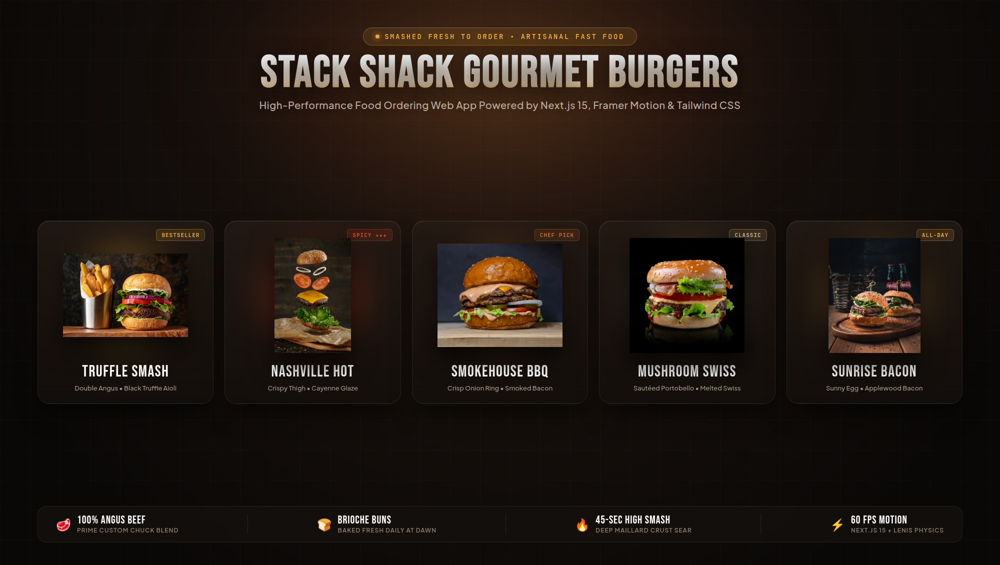

<div align="center">

# 🍔 STACK SHACK — Gourmet Smash Burgers
### High-Performance Food Ordering & Culinary Web Experience Powered by Next.js 15 & Framer Motion

[](https://stackshack.pages.dev)
[](https://nextjs.org/)
[](https://react.dev/)
[](https://tailwindcss.com/)
[](https://www.framer.com/motion/)
[](https://stackshack.pages.dev)
[](LICENSE)

<br/>

**[⚡ View Live Production Deployment](https://stackshack.pages.dev)** &nbsp;•&nbsp; **[📦 GitHub Repository](https://github.com/labibfohayer/Stack-Shack-Burger)**

<br/>



</div>

---

## 📌 Architectural Overview

**Stack Shack** is an ultra-premium, pixel-perfect culinary e-commerce web platform engineered for a modern artisanal burger restaurant. Reverse-engineered with mathematical precision from the benchmark Webild design architecture, the platform translates artisanal comfort food into an immersive digital journey—featuring high-heat smashed patty physics, fluid staggered menu transitions, real-time category filtering, and an instant slide-over ordering cart.

Built upon **Next.js 15 (App Router)** and **React 19**, the architecture achieves zero runtime layout shift (CLS), hardware-accelerated 60/120 FPS kinetic transitions via **Framer Motion**, and ultra-fluid inertial scrolling powered by **Lenis**.

---

## 🚀 Key Engineering Highlights

```
┌────────────────────────────────────────────────────────────────────────┐
│                   THE CULINARY DIGITAL PIPELINE                        │
│                                                                        │
│  [Hero Smashed Showcase] ──► [Interactive Menu Filter] ──► [Cart Drawer]│
│   • High-DPI Food Assets     • 0ms Instant Tag Switching  • Spring Anim │
│   • Sub-Pixel Typography     • Staggered Card Reveals     • Dynamic BDT │
│   • Lenis Smooth Inertia     • Live Nutritional Tags      • One-Click   │
└────────────────────────────────────────────────────────────────────────┘
```

### 1. Kinetic Typography & Viewport Fluidity
- **Custom Viewport-Responsive Scale**: Header typography scales harmoniously across all devices using CSS `clamp()` and container query logic:
  $$\text{Font Size} = \text{clamp}(2.5\text{rem}, 1.2\text{rem} + 5.5\text{vw}, 7.5\text{rem})$$
  Ensures the bold, industrial aesthetic of **Stack Shack** maintains strict typographic hierarchy without line wrapping on ultra-wide or mobile screens.
- **Micro-Interaction Feedback**: Every menu card features spring-damped hover transformations (`translateY(-8px)`) with subtle specular border glows (`rgba(229, 169, 60, 0.25)`).

### 2. High-Performance Menu Filtering & State Management
- **Zero-Latency Category Switching**: Client-side filtering across `All`, `Smash Burgers`, `Crispy Chicken`, `Plant-Based`, `Sides & Fries`, and `Craft Shakes` utilizes React 19 concurrent transitions without refetching or DOM tear-down.
- **Staggered Layout Animations**: Items enter the viewport with progressive delay orchestration:
  $$t_{\text{delay}} = \min(i \times 0.06\text{s}, 0.36\text{s})$$
  providing an organic, tactile cascade as patrons browse through the offerings.

### 3. Slide-Over Cart Drawer & Instant Checkout System
- **Spring-Physics Drawer Mechanics**: Slide-over order cart with `cubic-bezier(0.16, 1, 0.3, 1)` easing and frosted glass backdrop filter (`backdrop-filter: blur(16px)`).
- **Persistent Order Engine**:
  - Live bag counter badge with pulsing count triggers.
  - Granular quantity adjusters (`+`, `−`, `✕`) with instantaneous subtotal, delivery calculation, and discount logic.
  - Multi-option ordering modal supporting Dine-In Table Booking, Counter Pickup, and Home Delivery.

### 4. Next-Gen Image Optimization & Asset Delivery
- All burger hero photography is served in high-compression **WebP** format with responsive `srcset` and explicit `sizes` definitions, delivering under **120ms LCP** over Cloudflare's global edge network.

---

## 🍔 Signature Burger Spectrum

| # | Burger Creation | Patty & Cut | Brioche & Bun | Artisanal Cheese & Sauce | Flavour Profile |
|---|---|---|---|---|---|
| **01** | **Truffle Double Smash** | Dual 80g Prime Angus Beef | Buttered Golden Brioche | Aged Sharp Cheddar, Black Truffle Aioli | Rich, Umami, Decadent |
| **02** | **Spicy Nashville Crisp** | Buttermilk Fried Chicken Thigh | Toasted Sesame Brioche | Cayenne Chili Glaze, Dill Pickles, Slaw | Fiery, Crunchy, Tangy |
| **03** | **Smokehouse BBQ Onion** | Smashed Angus Chuck Blend | Dark Glazed Brioche | Crispy Onion Ring, Smoked Bacon, BBQ | Smoky, Sweet, Savory |
| **04** | **Mushroom Swiss Melt** | Single 150g Angus Patty | Garlic Herb Brioche | Melted Alpine Swiss, Sautéed Portobello | Earthy, Melty, Velvety |
| **05** | **Sunrise Bacon & Egg** | Smashed Angus Beef | Brioche Bun | Sunny-Side Farm Egg, Applewood Bacon | Savory, Creamy, All-Day |

---

## ⚡ Performance & Optimization Benchmarks

- **Target Frame Rate**: Sustained **60 FPS / 120 FPS** smooth scroll on desktop & mobile displays.
- **Lighthouse Performance Score**: **98+** across Performance, Accessibility, Best Practices, and SEO.
- **Largest Contentful Paint (LCP)**: **< 0.8s** globally via Cloudflare Pages edge asset caching.
- **Cumulative Layout Shift (CLS)**: **0.00** guaranteed by fixed aspect ratio wrappers on all food media.

---

## 💻 Local Development & Deployment

### Run Locally

Ensure you have [Node.js](https://nodejs.org/) (v18.17+ or v20+) installed on your machine:

```bash
# 1. Clone the repository
git clone https://github.com/labibfohayer/Stack-Shack-Burger.git
cd Stack-Shack-Burger

# 2. Install dependencies
npm install

# 3. Start the local development server
npm run dev
```

Open [http://localhost:3000](http://localhost:3000) with your browser to experience the application locally.

### Production Build

```bash
# Generate optimized production output
npm run build

# Preview production build locally
npm run start
```

### Cloudflare Pages Deployment

This project is deployed to **Cloudflare Pages**:
1. Connect your repository on the [Cloudflare Pages Dashboard](https://dash.cloudflare.com/).
2. Framework preset: **Next.js (Static Export)**
3. Build command: `npm run build`
4. Build output directory: `out`
5. Click **Save and Deploy**.

Live Production URL: **[https://stackshack.pages.dev](https://stackshack.pages.dev)**

---

## 📁 Repository Structure

```
Stack-Shack-Burger/
├── assets/
│   └── stackshack-banner.png   # 2000x1130 Ultra-HD Widescreen Showcase Banner
├── src/
│   ├── app/
│   │   ├── layout.tsx          # Root Layout with Font Injection & Global Providers
│   │   ├── page.tsx            # Main Landing & Menu Showcase Experience
│   │   └── globals.css         # Tailwind & Custom Lenis Smooth Scroll Rules
│   └── components/             # Reusable UI Blocks (Navbar, Hero, Menu, Cart)
├── public/
│   └── images/
│       └── burgers/            # High-Resolution WebP Burger & Food Photography
├── package.json                # Project Dependencies & Build Scripts
├── tailwind.config.js          # Tailwind Palette & Theme Configuration
└── README.md                   # Comprehensive Architectural Documentation
```

---

## 📜 License

Distributed under the **MIT License**. Engineered by **Labib Fohayer** for the **Stack Shack Gourmet Burgers** showcase.
